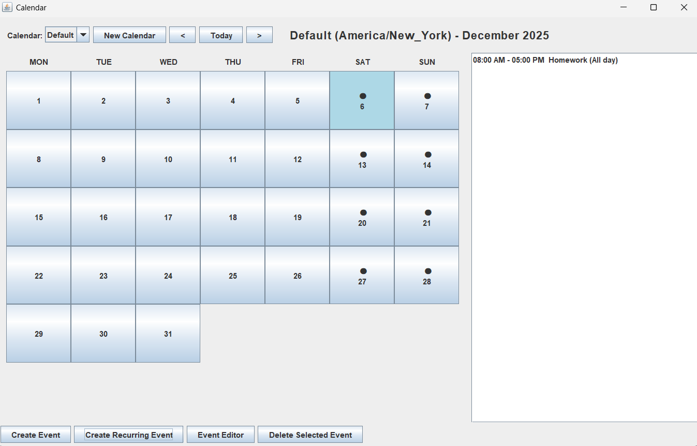
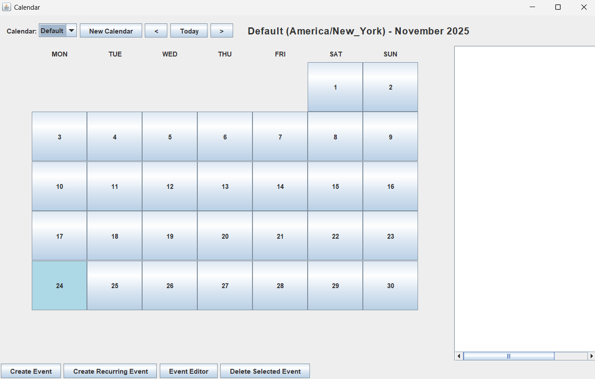
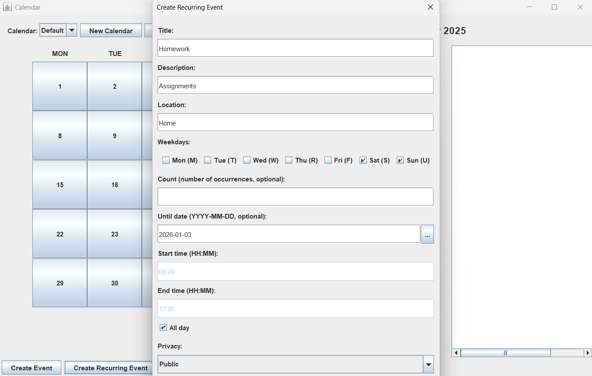
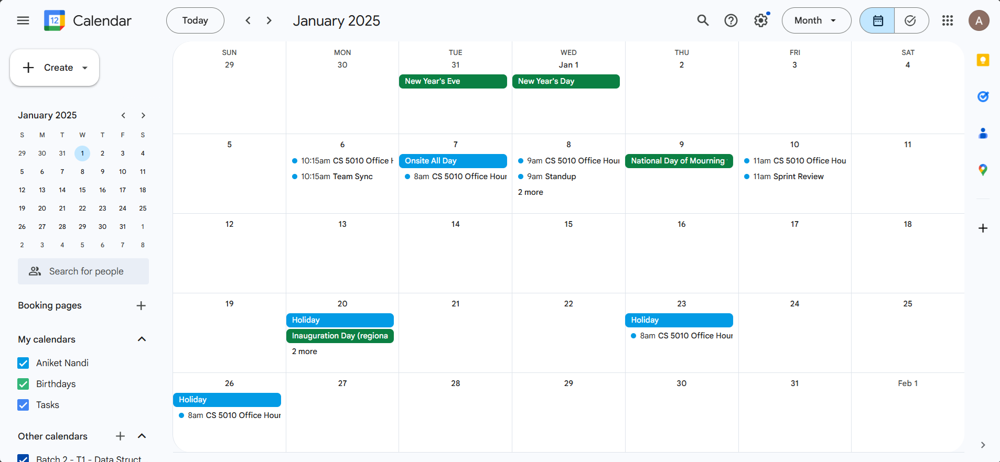
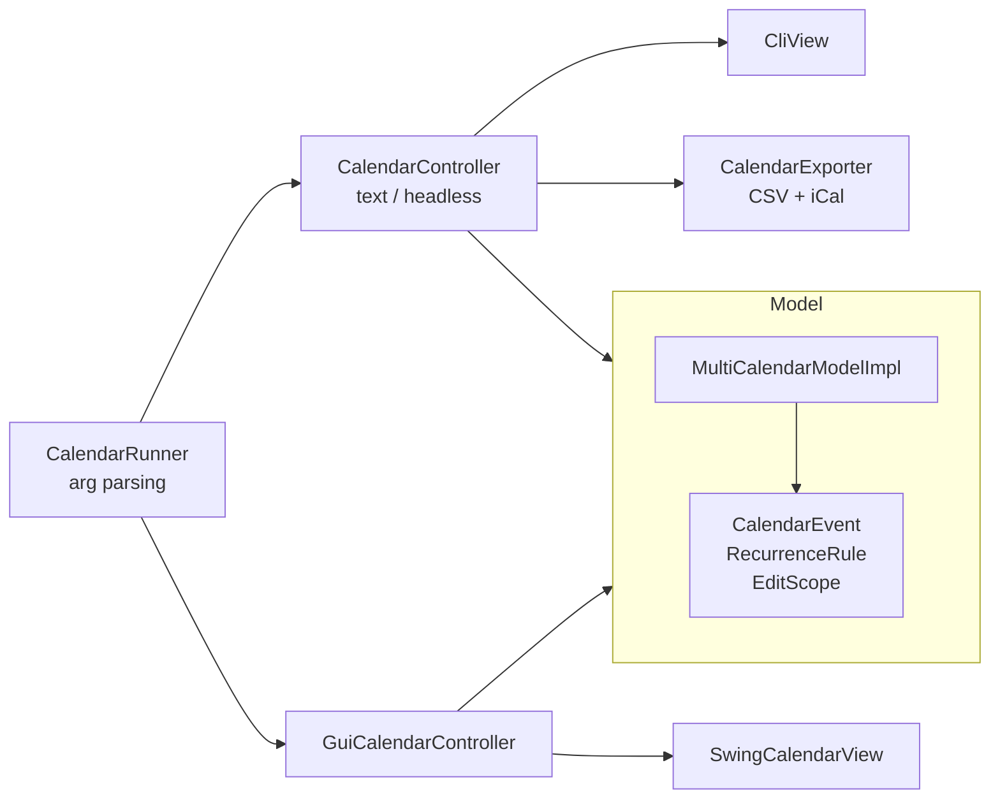

# Event-Handling Calendar App

[](https://github.com/aniketnandi/Event-Handling-Calendar-App/actions/workflows/build.yml)


A desktop calendar app in Java with **three front ends over one model**: a Swing GUI, an
interactive command line, and a headless script runner. It supports multiple calendars in
different time zones and recurring events with scoped edits. Calendars export to CSV and
iCalendar (`.ics`) files that import cleanly into Google Calendar.

<p align="center">
  
</p>

## Highlights

- **Strict MVC separation.** The model has no Swing or I/O code. The text controller and the
  GUI controller are separate classes behind interfaces (`TextController`, `GuiFeatures`,
  `GuiView`), so you can swap a view without changing the model.
- **Recurring events.** A series repeats on chosen weekdays, either *N* times or until a date.
  You can edit one occurrence, this one and all after it, or the whole series. Edits are
  matched by a stable `seriesId`, so one-off events with the same title aren't touched.
- **Time-zone-aware multi-calendar model.** Each calendar has an IANA `ZoneId`. When you copy
  events between calendars (one event, one day, or a date range), their times are converted
  to the target calendar's zone.
- **Conflict detection with rollback.** If a bulk edit would collide with an existing event,
  the whole edit is undone and the user sees a clear error.
- **Standards-compliant export.** CSV follows Google Calendar's import format. iCalendar output
  follows RFC 5545: CRLF line endings, `VEVENT` blocks, and stable UIDs.
- **Extensive test suite.** 756 JUnit tests cover the model, the controllers, the exporters
  and argument parsing. JaCoCo, Checkstyle and PIT mutation testing are set up in Gradle.

## Quick start

Requires **JDK 17+**. The Gradle wrapper is included.

```bash
git clone https://github.com/aniketnandi/Event-Handling-Calendar-App.git
cd Event-Handling-Calendar-App
./gradlew jar

java -jar build/libs/calendar-1.0.jar                                        # GUI
java -jar build/libs/calendar-1.0.jar --mode interactive                     # REPL
java -jar build/libs/calendar-1.0.jar --mode headless examples/commands.txt  # run a script
```

On Windows, use `gradlew.bat jar`.

## Command language

The text modes use a small command language:

```text
create calendar --name Work --timezone America/New_York
use calendar --name Work

create event "Standup" from 2025-01-08T09:00 to 2025-01-08T09:15 repeats MTWRF for 10 times
create event "Office Hours" from 2025-01-08T14:00 to 2025-01-08T15:00 repeats MR until 2025-02-05
edit series location "Office Hours" from 2025-01-08T14:00 with "Zoom"

copy events between 2025-01-08 and 2025-01-20 --target School to 2025-01-13
print events on 2025-01-10
show status on 2025-01-10T11:30
export cal work_jan.ics
```

The full walkthrough is in [`examples/commands.txt`](examples/commands.txt).
[`examples/invalid.txt`](examples/invalid.txt) shows how malformed input is reported.

## Screenshots

| Home | Create event |
| --- | --- |
|  |  |

**Exported `.ics` imported into Google Calendar:**



## Architecture



```text
src/main/java/
├── CalendarRunner.java          # entry point: picks GUI / interactive / headless mode
└── calendar/
    ├── model/                   # calendars, events, recurrence, time-zone logic
    ├── controller/              # text command parser and GUI controller
    ├── view/                    # CLI view and Swing views
    └── export/                  # CSV and iCalendar writers
```

The full UML class diagram is in [`docs/images/class-diagram.png`](docs/images/class-diagram.png).
Design decisions and their trade-offs are in [`docs/DESIGN.md`](docs/DESIGN.md).

## Testing

```bash
./gradlew test                 # unit tests + JaCoCo report (build/reports/jacoco)
./gradlew checkstyleMain       # Google-style Checkstyle rules
./gradlew pitest               # mutation testing (build/reports/pitest)
```

GitHub Actions builds the project and runs the tests on every push.

## Documentation

- [Usage guide](docs/USAGE.md): every GUI operation and command, step by step
- [Design notes](docs/DESIGN.md): architecture, feature matrix, known limitations
- [Design history](docs/DESIGN-HISTORY.md): how the design evolved from a single calendar to
  multiple calendars with export

## Known limitations

- Events are kept in memory only. Export to CSV or iCal to keep them; importing is not
  supported.
- The GUI shows a month view only. There are no week or day views.
- Calendars can be renamed or moved to another time zone from the command line, but not from
  the GUI yet.

## Background

I built this as a semester-long project for CS 5010 (Programming Design Paradigms) at
Northeastern University. It grew in stages: first a single-calendar text app, then multiple
calendars with time zones and export, and finally the Swing GUI.
