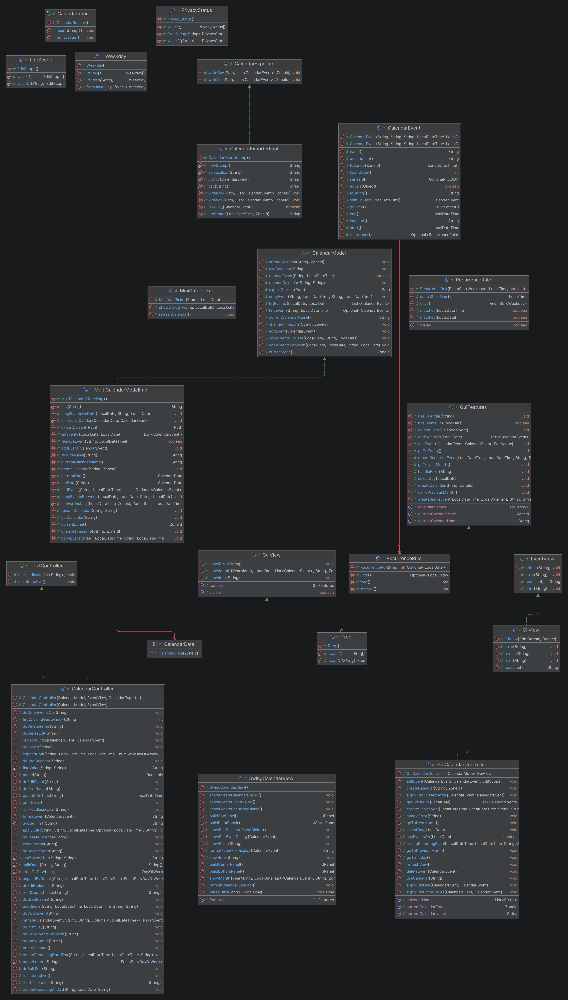

# Design Notes

## Architecture: Model-View-Controller

The app has to support three ways of interacting: a Swing GUI, an interactive REPL and a
headless script runner. All three share one model, so the code is split along MVC lines.

| Layer | Classes | Responsibility |
| --- | --- | --- |
| Model | `CalendarModel`, `MultiCalendarModelImpl`, `CalendarEvent`, `RecurrenceRule`, `EditScope`, `PrivacyStatus`, `Weekday` | Calendars, events, recurrence, conflict rules and time-zone conversion. No Swing and no file I/O. |
| Controller | `TextController` / `CalendarController`, `GuiFeatures` / `GuiCalendarController` | Turns user intent (a text command or a GUI action) into model calls and reports results or errors to the view. |
| View | `EventView` / `CliView`, `GuiView` / `SwingCalendarView`, `MiniDatePicker` | Display only: prints output, or renders the month grid, dialogs and error messages. |
| Export | `CalendarExporter` / `CalendarExporterImpl` | Writes CSV (Google Calendar format) and iCalendar (RFC 5545) files. |

`CalendarRunner` reads the command-line arguments and wires up the right controller and view.

### Why MVC (and not MVP or MVVM)

The main need is several views on top of one model, and MVC handles that directly. A separate
Presenter or ViewModel layer, or full Command objects, would add indirection without much
benefit at this size. Because the GUI and text front ends talk to the model through
interfaces, each one can change without affecting the model or the other front end.

### Key decisions

| Decision | Rationale |
| --- | --- |
| Separate controllers for text and GUI | The two front ends interact very differently. The text controller parses a command grammar, while the GUI controller handles events and structured dialog input. Keeping them apart keeps each one small and focused. |
| `GuiFeatures` interface between view and controller | The Swing view only calls feature methods such as `createEvent` and `editEvent`. It never touches the model, so the controller can be tested with a fake view. |
| Time zone stored per calendar, not per event | Every event in a calendar uses that calendar's zone. Keeping zone conversion in the model means it is written once, not repeated in each controller. |
| Stable `seriesId` for recurring events | Edits like "this and after" or "entire series" target exactly one series, never unrelated events that happen to share a title. Events that aren't in a series fall back to matching by name. |
| Bulk edits are all-or-nothing | If a series edit or date shift would cause a conflict, every change is rolled back. The model is never left half-edited. |
| Export is a separate service | File I/O stays out of the model, and adding a new format means adding a new exporter method without touching the model (Open/Closed principle). |
| Friendly error messages | Controllers catch validation and parsing errors and show a short message (`Error: ...` in text mode, a dialog in the GUI). Users never see stack traces. |

## Feature matrix

| Feature | Text / headless | GUI |
| --- | :---: | :---: |
| Multiple calendars with IANA time zones | ✅ | ✅ |
| Default calendar in the system time zone | — | ✅ |
| Switch the active calendar | ✅ | ✅ |
| Rename a calendar or change its time zone | ✅ | ❌ |
| Single and all-day events | ✅ | ✅ |
| Recurring events (weekdays + count / until) | ✅ | ✅ |
| Edit: single / this-and-after / entire series | ✅ | ✅ |
| Delete an event | ✅ | ✅ |
| Copy events across calendars (with zone conversion) | ✅ | ❌ |
| View events on a day | ✅ | ✅ |
| Query a date-time range; busy/free status | ✅ | ❌ |
| Export to CSV and iCalendar | ✅ | ❌ |
| Import from CSV or iCalendar | ❌ | ❌ |

## Known limitations

- **No persistence.** Events live in memory and are lost when the program exits. Exporting is
  the only way to keep data.
- **GUI tests.** Swing components are not driven by automated UI tests. Controller logic is
  tested against a fake `GuiView`, and the Swing layer was checked by hand.
- **Month view only.** There are no week or day views and no drag-and-drop editing.

## Development history

The project was built in three stages:

1. **Single calendar, text mode.** The event model, recurrence rules, scoped edits, and the
   command parser for interactive and headless modes.
2. **Multiple calendars and time zones.** `MultiCalendarModelImpl`, copying events across
   calendars with zone conversion, and CSV/iCal export. See
   [DESIGN-HISTORY.md](DESIGN-HISTORY.md) for the details of this refactor.
3. **Swing GUI.** `GuiView`, `GuiFeatures`, `GuiCalendarController` and `SwingCalendarView`.
   These were added without changing the model.
